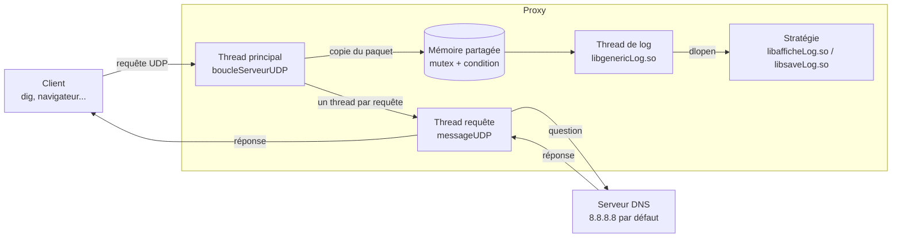

# Proxy DNS multithreadé en C

Serveur mandataire DNS (proxy) écrit en C pour Linux : il reçoit les requêtes DNS des clients, les relaie vers un vrai serveur DNS et renvoie les réponses. Chaque requête est traitée dans son propre thread, et un thread séparé journalise le trafic grâce à des plugins chargés à l'exécution.

## Sommaire

- [Ce que montre le projet](#ce-que-montre-le-projet)
- [Architecture](#architecture)
  - [Organisation du code](#organisation-du-code)
- [Le projet en 4 étapes](#le-projet-en-4-étapes)
- [Compilation](#compilation)
- [Utilisation](#utilisation)
- [Crédits](#crédits)

## Ce que montre le projet

- Sockets UDP (`socket`, `bind`, `recvfrom`, `sendto`) et format des paquets DNS (RFC 1035)
- Threads POSIX : un thread par requête, plus un thread de log
- Mémoire partagée entre threads (tampon circulaire), protégée par un mutex et une variable de condition
- Bibliothèque statique (`libreseau.a`) et bibliothèques dynamiques (`.so`)
- Chargement de plugins à l'exécution avec `dlopen` / `dlsym` (patron de conception *stratégie*)
- Options en ligne de commande avec `getopt_long`
- Compilation par Makefiles imbriqués, avec `-Wall -Wextra -Werror`

## Architecture



1. Le thread principal attend les requêtes sur le port d'écoute (53 par défaut).
2. Pour chaque requête reçue, il lance un thread détaché (`launchThread`). Ce thread envoie la question au serveur DNS, attend la réponse (3 s au maximum) et la renvoie au client.
3. En parallèle, le paquet est copié dans la mémoire partagée, un tampon circulaire de 1 Ko. Chaque message y est précédé de sa taille, ce qui permet au lecteur de les récupérer un par un. Si le tampon est plein parce que le thread de log a pris du retard, le paquet n'est pas journalisé, mais la requête est quand même relayée.
4. Le thread de log attend sans consommer de CPU qu'un message arrive, puis le transmet à la stratégie chargée.

### Organisation du code

```
.
├── Makefile               compile toutes les bibliothèques puis le programme
├── src/main.c             lecture des options et lancement du serveur
└── libs/
    ├── Reseau/            libreseau.a   : socket d'écoute, boucle serveur, relais d'une requête
    ├── Threads/           libthread.so  : launchThread(), création générique de threads
    ├── Memoire/           libmemoire.so : mémoire partagée producteurs / consommateur
    └── Log/
        ├── libgenericLog.so  gestionnaire : charge la stratégie et fait tourner le thread de log
        ├── libafficheLog.so  stratégie : affiche le nom de domaine de chaque question
        └── libsaveLog.so     stratégie : enregistre chaque paquet en hexadécimal dans un fichier
```

Toutes les stratégies de log exposent la même interface (`log_dns.h`) :

```c
int initLog(void *param);        // appelée une fois (ex : ouverture du fichier)
int addLog(logMsg_t *message);   // appelée pour chaque paquet DNS reçu
```

Pour ajouter une nouvelle stratégie (filtrage, statistiques...), il suffit d'écrire une `.so` qui implémente ces deux fonctions. Le proxy n'a pas besoin d'être recompilé.

## Le projet en 4 étapes

Le projet a été construit de façon incrémentale, avec une refactorisation à chaque étape. Ce dépôt contient la version finale (étape 3).

| Étape | Objectif | Ce qui a été fait |
|---|---|---|
| **0. Proxy minimal** | Avoir un proxy qui fonctionne | Un seul fichier `proxy.c` : une boucle qui reçoit une requête, la relaie vers le serveur DNS et renvoie la réponse. Une seule requête à la fois. |
| **1. Refactorisation** | Rendre le code réutilisable | Découpage en `src/`, `libs/`, `bin/` et création de la bibliothèque statique `libreseau.a` (`initialisationSocketUDP`, `messageUDP`, `boucleServeurUDP`). La boucle serveur reçoit en paramètre un pointeur sur la fonction de traitement. Ajout des options avec `getopt_long`. |
| **2. Logs** | Journaliser sans recompiler | Patron *stratégie* avec des bibliothèques dynamiques : un gestionnaire (`libgenericLog.so`) charge avec `dlopen` la stratégie donnée par `-l`, et l'option `-i` transmet son paramètre d'initialisation. Deux stratégies sont fournies : affichage des domaines et sauvegarde dans un fichier. |
| **3. Multithreading** | Traiter les requêtes en parallèle | Bibliothèque `libthread.so` (`launchThread`) : un thread par requête. Bibliothèque `libmemoire.so` : mémoire partagée entre les threads de requête et un thread dédié aux logs. |

## Compilation

Prérequis : Linux, `gcc`, `make`. Pour tester : `dig`, fourni par le paquet `bind-utils` ou `dnsutils`.

```sh
make
make clean
```

## Utilisation

```
./bin/main [OPTIONS]

  -h, --help                       affiche l'aide
  -p, --port <port>                port d'écoute (défaut : 53)
  -s, --serveur <ip>               serveur DNS amont (défaut : 8.8.8.8)
  -l, --logstrategie <strategie>   stratégie de log à charger (optionnel)
  -i, --initlogstrategie <arg>     paramètre de la stratégie, ex : fichier de logs
```

Écouter sur le port 53 demande les droits root. Pour tester sans `sudo`, utilisez un port au-dessus de 1024 :

```sh
# Terminal 1 : proxy sur le port 5300 qui affiche les domaines demandés
./bin/main -p 5300 -l libafficheLog.so

# Terminal 2
dig @127.0.0.1 -p 5300 google.com
```

```
>> Requête client reçue
   Nom de domaine de la requête : google.com
   Requête traitée
```

Enregistrer toutes les requêtes dans un fichier :

```sh
./bin/main -p 5300 -l libsaveLog.so -i logs.txt
```

Chaque ligne de `logs.txt` contient un paquet DNS en hexadécimal :

```
71de01200001000000000001076578616d706c6503636f6d0000010001...
```

Pour faire passer par le proxy toutes les résolutions de la machine, lancez-le sur le port 53 (`sudo ./bin/main`) et indiquez `127.0.0.1` comme serveur DNS dans la configuration réseau.

## Crédits

- Thomas Delobelle
